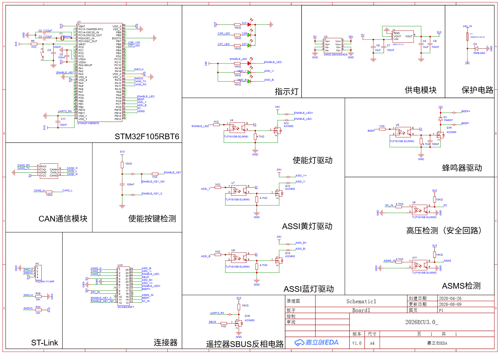
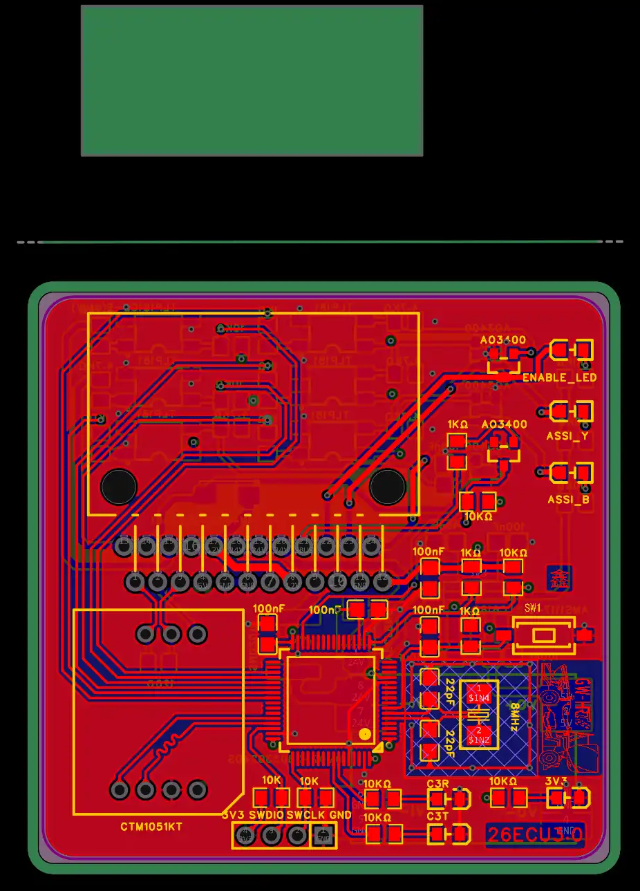

# HRT 26D ECU

HRT 赛车队 26D 赛季整车 ECU 固件。

STM32F1 平台（CMSIS 使用 `stm32f10x_cl` 启动文件）+ ST 标准外设库，Keil MDK5 工程。

## 功能模块

| 模块 | 文件 | 说明 |
| --- | --- | --- |
| 主程序 | `User/main.c` | 初始化 + 10 ms 周期任务调度 |
| 10 ms 任务 | `User/stm32f10x_it.c` → `ECU_Task_10ms()` | 整车状态机主逻辑 |
| CAN 通信 | `User/CAN.c` | 整车报文收发（`HRT_CTRL` 0x156 等） |
| 串口 | `User/USART.c` | 调试输出与 SBUS 接收 |
| 定时器 | `User/TIME.c` | 系统时基 |
| GPIO | `User/GPIO.c` | 指示灯与使能信号 |
| 状态标志 | `User/Flag.c` | 全局状态位管理 |

## 硬件设计

主控 **STM32F105RBT6**，PCB 使用 **嘉立创 EDA 专业版** 绘制，工程文件 `ProPrj_2026ECU3.0.epro2`（打开方式：嘉立创 EDA 专业版 → 打开工程）。

| 功能块 | 说明 |
| --- | --- |
| 主控 | STM32F105RBT6，8 MHz 晶振，SWD（ST-Link）调试口 |
| 供电 | 24 V 输入 → 5 V → AMS1117-3.3 |
| 保护 | SMBJ24A TVS + 1N4148，24 V 输入侧 |
| CAN | CAN3 收发模块，120 Ω 终端电阻 |
| 遥控输入 | SBUS 反相电路 → `UART3_RX`（PB11），100000 baud / 9 数据位 / 偶校验 / 2 停止位 |
| 指示灯 | ENABLE_LED / ASSI_Y / ASSI_B 三路，TLP181 光耦隔离 + AO3400 低边驱动 |
| 其它 | 蜂鸣器驱动、使能按键检测、ASMS 检测、高压检测（安全回路） |

原理图：



PCB 布局（顶层）：



> `.epro2` 是二进制 EDA 工程，Git 无法逐行比较，每次保存都是整文件替换，仓库体积会随之增长。

## 目录结构

```
ECU20263.1/
├── ECU26DVersionFinal/      # 固件（Keil MDK5 工程）
│   ├── CMSIS/               # 内核与启动文件
│   ├── FWLIB/               # ST 标准外设库
│   ├── Project/             # ASECU.uvprojx
│   └── User/                # 业务代码
├── docs/images/             # README 配图（原理图、PCB、接线图）
├── ProPrj_2026ECU3.0.epro2  # PCB 工程（嘉立创 EDA 专业版）
├── 遥控器.md                # SBUS 遥控功能说明
└── README.md
```

## 构建

用 Keil MDK5 打开 `ECU26DVersionFinal/Project/ASECU.uvprojx`，编译 target `无人ECU`。

> 编译产物（`Objects/`、`Listings/`）和 Keil 个人配置（`*.uvoptx`、`*.uvguix.*`）已在 `.gitignore` 中排除，克隆后需重新编译。

> 仓库内源码统一为 **UTF-8（带 BOM）**。若在 Keil 中打开中文注释显示为乱码，把 `Edit → Configuration → Editor → Encoding` 改成 `UTF-8` 即可。

## 文档

- [遥控器使用说明（SBUS）](遥控器.md)

## 说明

本项目为车队内部工程代码，版权归 HRT 赛车队所有。未经许可，不得用于其他参赛车辆或商业用途。
