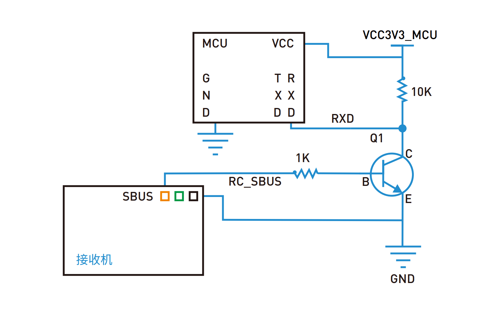

# 遥控器使用说明（SBUS）

## 1. 功能概述

- 使用 SBUS 遥控器在无人遥控模式（`Match_Mode == 11`）且 ROS 掉线（`ROS_LOSE_Flag == 255`）时接管车辆。

## 2. 硬件接线

| 信号 | 引脚 |
| --- | --- |
| 接收机 SBUS 输出 | USART3_RX，即 PB11 |

串口参数：100000 baud，9 位数据，偶校验，2 停止位，仅接收。

## 3. 通道定义

当前按 6C-MINI 右手油门模式配置：

| 摇杆操作 | SBUS 通道 | 功能 | 输出范围 |
| --- | --- | --- | --- |
| 左摇杆左右 | 通道 4 | 方向 | -7 ~ +7 度，左正右负 |
| 右摇杆上下 | 通道 3 | 速度 | 0 ~ 3 m/s |

## 4. 使用步骤

1. 上电前把两个摇杆放回中位。
2. 确认进入无人遥控模式：`Match_Mode == 11` 且 ROS 掉线。
3. 自动校准：把方向摇杆左右各推到底一次，把油门摇杆上下各推到底一次，最后回中。两个轴都完成行程扫描并回中后，校准才生效，校准完成前方向、速度都输出 0。
4. 正常行驶：右摇杆上推加速，左摇杆左右转向。方向为左正右负。
5. 进入停车：油门推到底保持约 0.7 秒，进入停车锁定，速度归零。
6. 解除停车：停车状态下把油门推到高位保持约 0.2 秒，然后回中，才能重新加速。
7. 信号丢失：超过 `LOST_TIMEOUT` 次未收到完整帧，或 SBUS 帧标志位 `0x10` / `0x20` 置位时，方向归中、速度归零、`lost = 1`。

## 5. 输出状态

`CarControl_t SBUS` 字段：

| 字段 | 含义 |
| --- | --- |
| `steering_deg` | 方向角，-7 ~ +7，左正右负，CAN 接收端需再乘 3 |
| `speed_m_s` | 速度，0 ~ 3 m/s，内部为整数 m/s |
| `parked` | 1 表示停车锁定 |
| `lost` | 1 表示信号丢失或失控保护 |
| `driving` | 1 表示校准完成、未停车、未丢信号、未处于回中锁定 |

`driving == 1` 只代表遥控状态正常，不代表车正在移动；摇杆回中且速度输出 0 时 `driving` 仍可能为 1。

指示灯设置：

| 状态 | ASSI 效果 |
| --- | --- |
| `driving == 1`（上使能） | 黄灯闪烁 |
| `lost == 1`（下使能） | 蓝灯闪烁 |
| `parked == 1`（下使能） | 蓝灯常亮 |

## 6. CAN 打包

整车报文 `HRT_CTRL` 中与遥控相关的字节：

| 字节 | 内容 |
| --- | --- |
| `Data[5]` | 低 4 位 `Emergency_Flag`，高 4 位方向 `SBUS.steering_deg << 4`，有符号 -7 ~ +7 |
| `Data[7]` | `Motor_EN_State`、`SC_OUT`、`RES_GO` 以及 `(SBUS.speed_m_s * 2) << 5` |

速度按 0.5 m/s 步进发送：0 -> 0，1 -> 2，2 -> 4，3 -> 6，接收端读取高 3 位后除以 2 得到真实 m/s。

## 7. 实现原理

### SBUS 帧格式

SBUS 每帧 25 字节：

- 字节 0：帧头 `0x0F`
- 字节 1 ~ 22：16 个通道，每通道 11 bit，按位连续排列
- 字节 23：状态标志，`0x10` 信号丢失，`0x20` 失控保护
- 字节 24：帧尾 `0x00`

### 接收流程

1. USART3 接收中断逐字节组装 `Serial_SBUSFrame[25]`，收到完整帧后置 `Serial_SBUSFrameFlag`。
2. `Serial_GetSBUSFrame()` 拷贝帧时关闭 USART3 接收中断，防止拷贝到一半被新帧覆盖。
3. `SBUS_ParseChannels()` 从 25 字节帧中解出 16 个 11 bit 通道值。
4. 原始值经过 `ClampRaw()` 限幅到 200 ~ 1800。

### 自动校准

- 以中位 1000 为 0 点，实时扩展每个轴的 `min_raw` / `max_raw`。
- 一个轴需要左右两侧行程都大于等于 `CALIB_MIN_SIDE`，且总跨度大于等于 `CALIB_MIN_DEVIATION`，摇杆回到中位后锁定校准。
- 有效半行程取左右两侧偏差中较大者，方向/速度按“原始值 - 中位”线性映射。
- 中位附近有 ±30 死区，防止手抖导致输出抖动。

### 停车与回中锁定

- `throttle_bottom`：油门原始值低于最低点 +100，视为推到底。
- `throttle_active`：油门超过中位 + 70% 有效半行程，视为推高。
- 推到底累计 70 次进入停车，推高累计 20 次且处于停车状态时解除停车。
- 解除停车后 `rearm = 1`，必须回到中位才能重新输出速度，避免一解除就窜车。

### 信号丢失

- 没有新帧时 `timeout` 累加，超过 `LOST_TIMEOUT` 判定丢失。
- 收到帧标志 `0x10` / `0x20` 时立即判定丢失。
- 丢失后方向、速度立即归零，恢复后需重新收到有效帧。

## 8. 关键参数

| 宏 | 值 | 含义 |
| --- | --- | --- |
| `SBUS_RAW_MIN` / `SBUS_RAW_MAX` | 200 / 1800 | 原始值限幅范围 |
| `SBUS_RAW_CENTER` | 1000 | 中位原始值 |
| `DEADZONE` | 30 | 中位死区 |
| `STEERING_MAX_DEG` | 7 | 方向最大输出 |
| `SPEED_MAX_CM_S` | 3 | 速度最大输出，单位 m/s |
| `CALIB_MIN_SIDE` | 150 | 每侧最小行程 |
| `CALIB_MIN_DEVIATION` | 200 | 总行程最小跨度 |
| `PARK_ENTER_FRAMES` | 70 | 进入停车累计次数 |
| `PARK_EXIT_FRAMES` | 20 | 解除停车累计次数 |
| `PARK_BOTTOM_OFFSET` | 100 | 推到底判定偏移 |
| `LOST_TIMEOUT` | 100 | 丢信号累计次数 |

## 9. 注意事项

- 方向 `-7 ~ +7` 是 ECU 输出值，CAN 接收端如需更大角度，需要再乘 3，对应 `-21 ~ +21`。
